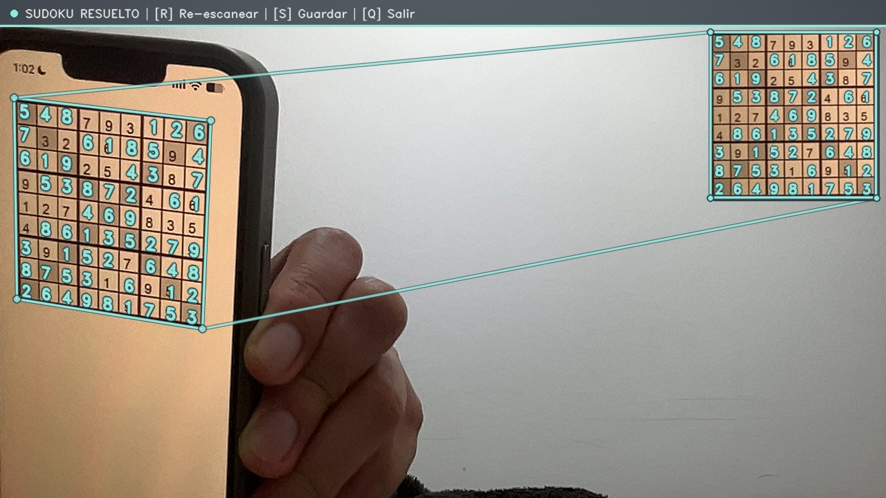

# Real-Time AR Sudoku Solver

A C++ computer vision application built with **OpenCV** and **Qt5** that detects, recognizes, solves, and projects the solution of a 9×9 Sudoku puzzle in **real time** onto a live webcam stream (or static image).



## What It Solves

- **Perspective & Lighting Compensation**: Detects tilted or skewed Sudoku grids under uneven illumination and rectifies them via homography.
- **Fault-Tolerant OCR & Solving**: Recovers from noisy K-NN digit recognition using confidence scoring, multi-frame consensus voting, and automated conflict resolution before solving the board via Minimum Remaining Values (MRV) backtracking.
- **Dual Augmented Reality View**:
  - **Live Perspective Overlay**: Projects missing digits directly onto the physical/screen board in camera space.
  - **Persistent Picture-in-Picture (PiP)**: Keeps a cropped, rectified view of the solved board pinned to the top-right corner with outer-tangent callout lines until a new Sudoku is recognized.

## How It Works

1. **Detection (`getBox`)**: Applies adaptive Gaussian thresholding, quadrilateral contour filtering, temporal corner smoothing (EMA), and perspective warping (`getPerspectiveTransform`).
2. **Digit Recognition (`DigitRecognizer` & `extractSudokuDigits`)**: Slices the rectified grid into 81 cells, isolates centered ink components, and classifies digits (`20×30` px) using a cached `cv::ml::KNearest` model (`install/Character_Recognition/save.data`).
3. **Self-Healing Solver (`resolveAndSolveSudoku` & `solveSudoku`)**: Resolves OCR ambiguities using 2nd-best K-NN candidates and multi-frame voting, then solves the puzzle with MRV backtracking.
4. **AR & PiP Rendering (`overlaySolvedNumbers` & `drawSolvedCropPiP`)**: Warps the solved digits back onto the live board using the inverse homography (`invTransform`) and pins the rectified solved crop in the top-right corner using the **E2i 2026** color palette (`#244B5A` / `#99E6D8`).

## Build & Run

```bash
mkdir -p build && cd build
cmake ../cmake/src
cmake --build . -j4

# Real-time webcam mode (default)
./Sudoku_solver

# Static image mode
./Sudoku_solver <input_image_path> ../install/images/output.jpg
```

### Controls (Camera Mode)
- **`R`**: Reset / scan a new Sudoku (keeps current top-right solved crop until a new one is recognized)
- **`S`**: Save current frame to `../install/images/output.jpg`
- **`Q` / `ESC`**: Quit
